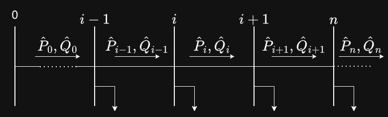

## Introduction

In this document, I review two papers. The first papers introduces the derivation is for three-phase, balanced systems. The second derviation is for three-phase unbalanced systems.

## First Paper: Network Reconfiguration in Distribution Systems for Loss Reduction and Demand Balancing, Baran et. al.

## Paper's Objectives

1- How can we change the network configuration to reduce resistive losses?
2- How can the load be distributed such that no overloads occur on the T-Lines?

## Equations Derivation

**NOTE: The paper uses DistFlow equations, which we are going to use in this work.**

Consider the following single line diagram:

::: {#fig-schematic layout-ncol=1}
{width=80%}

A single Line Diagram (SLD) for an $n$ bus system. The loads are unknown for now. The Apparent Power ($\bar{S}$) flowing between each bus is shown.
:::

For each load, we consider $P_{L_{n}}$ and $Q_{L_{n}}$, indicating load power flow at each load.

Below is the step-by-step calculation for the area of a circle.

```{python}
import handcalcs.render
from math import pi

radius = 5.0
```

```{python}
%%render
#| echo: false
Area = pi * radius**2
```

```{mermaid}
%%| label: fig-flowchart
%%| fig-cap: "The programmatic workflow of an engineering calculation report."
graph LR
    A[Raw Data] --> B(Poetry Env)
    B --> C{Quarto Engine}
    C -->|Executes Code| D[handcalcs Math]
    C -->|Renders Layout| E[HTML / PDF Report]
```