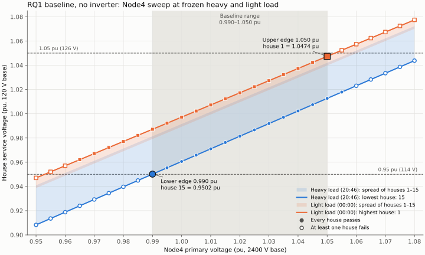
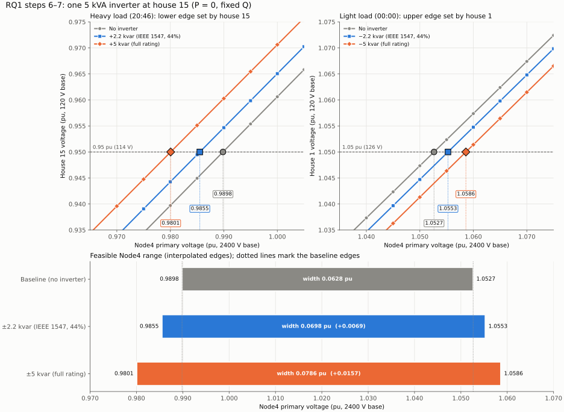
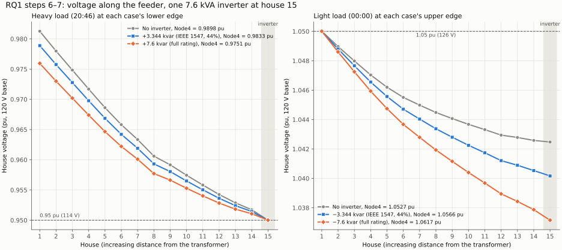
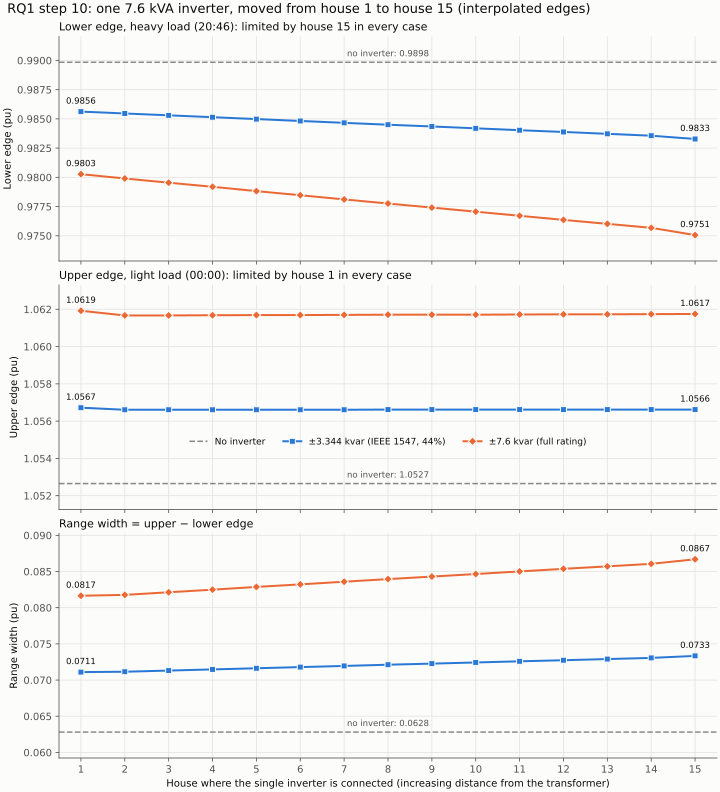

## Quantify the decoupling range.
Develop a sensitivity-based model that determines the decoupling range as a function of inverter count, location, phase assignment and rating.

## Next steps

I'd base the next steps on the voltage sensitivity we've already measured: how much a tap's voltage rises per $kVAr$ from an inverter at house $k$. Then work backwards from a target voltage to the $Q$ needed. Everything so far shows the rise is close to linear in $Q$:

**Proportional to Q:** going from $3.344~kvar$ to $7.6~kVAr$ multiplied every rise by about $\frac{7.6~kVAr}{3.344~kVAr}=2.27$. The increase of voltage, $\Delta V$ due to reactive power injection, $Q$ can be derived as follows:

- We previously derived the following:

$$
\Delta V \approx \frac{RP + XQ}{V}
$${#eq-voltage-change}

Since we are referencing the $Jacobian$, the submatrix $J_{4}$, states the relationship between $Q$ and the voltage magnitude $|V|$:

$$
J_{4} = \frac{\partial Q}{\partial |V|}
$$

and since we are only interested in the effect of $Q$, and not changing $P$, then:

$$
|\Delta V| \approx \frac{X\Delta Q}{V}
$${#eq-voltage-change-Q-only}

Where:

- $|\Delta V|:$ is the voltage change
- $X:$ The reactance of that specific segment where $Q$ is changing
- $\Delta Q:$ The change in $Q$; for instance: $\Delta Q = Q_{inj}=Q_{new}-Q_{ini}$

**NOTE:** The units of the above parameters depend on the units of the parameters we are using.

Measuring the voltage change, $\Delta V$ along the line, all the way up to the swing node, we need to consider the reactance of each segment, such that:

$$
X = X_{xfrmr}+\sum_{j=1}^{n} X_{ij}
$$

Substituting the reactance in @eq-voltage-change-Q-only, we get:

$$
|\Delta V| \approx \left(X_{xfrmr}+\sum_{j=1}^{n} X_{ij}\right) \frac{\Delta Q_{inj}}{V}
$$

In per unit voltage increase, we can divide both sides by $V_{base}$

$$
\Delta V_{k, p.u.} \approx \left(X_{xfrmr}+\sum_{j=1}^{n} X_{ij}\right) \frac{\Delta Q_{k,inj}}{V^{2}_{base}}
$${#eq-voltage-change-final}

Where $\boxed{k}$ is the house number, and $\boxed{n}$ is the node number

**Steady over the day:**

At a given tap, the rise barely changes with demand (for example $0.0064~pu$ to $0.0066~pu$ at tap 15). So each inverter location $k$ has one number, that is the **sensitivity**. Recall @eq-voltage-change-final:

$$\Delta V_{k, p.u.} \approx \left(X_{xfrmr}+\sum_{j=1}^{n} X_{ij}\right) \frac{\Delta Q_{k,inj}}{V^{2}_{base}}$$

If we solve for the relationship between the voltage at any tap $V_{k,pu}$ and $Q$, we can rewrite the above equation as:

$$
\Delta V_{k, p.u.} \approx \left(\frac{X_{xfrmr}+\sum_{j=1}^{n} X_{ij}}{V_{base}^{2}}\right) \Delta Q_{k,inj}
$$

Then solve for the relationship between the voltage at any tap $V_{k,pu}$ and $Q$:

$$
\frac{\Delta V_{k, p.u.}}{\Delta Q_{k,inj}} \approx X_{xfrmr}+\sum_{j=1}^{n} X_{ij}
$$

The first term, $\frac{\Delta V_{k, p.u.}}{\Delta Q_{k,inj}}$, describes how injecting the reactive power at house $k$ affects the voltage at tap $n$. Thus, hereafter it is called $\zeta=\frac{\Delta V_{k, p.u.}}{\Delta Q_{k,inj}}=$**Voltage Sensitivity.**

For instance, the voltage sensitivity at tap 15 is given by:

$$\zeta_{n=15,k} = \frac{\Delta V_{n=15}}{\Delta Q_{k=15}} \left[\frac{p.u.}{kVAr}\right]$$

and the $Q$ it needs is

$$\Delta Q_{k} = \frac{V_{target} - V_{base}}{\zeta_{15,k}}$$

### Therefore, the next steps are:

- **Pick a voltage target (p.u.)**: For example, "the worst tap (tap 15) at 20:46 reaches $V_{target}$".

- **Take S_15,k from the 44% location sweep:** we already have, for all 15 locations: $S = \frac{V_{rise,15}}{3.344~kVAr}$.

- **Calculate $Q_{k}$:** with the formula above and check it against the limits: $3.344 kVAr$ for IEEE 1547 at $44\%$, or $7.6~kVAr$ for the full rating.

- **Verify with one run per location:** Either GridLAB-D or the sweep script. If needed, correct once with $Q_{new} = \frac{Q + (V_{target} − V_{achieved})}{\zeta}$. The response bends slightly at high $Q$ (about $1.5\%$ between $44\%$ and $100\%$ at house $15$), so one correction should be enough.

### Example with numbers in the previous sections

Here the target is $V_{tap,15} = 0.970~pu$ at 20:46. The $V_{base}=0.9614 pu$, so the needed rise is $\Delta V = 0.0086~pu$.

| Inverter at | Rise at Tap 15 (3.344 kvar) | $\zeta_{15,k}~\left(\frac{pu}{kVAr}\right)$ | $Q_{needed}\left(kVAr\right)$ |
|:-----------:|---------------------------:|---------------------:|----------------:|
| House 1     | 0.00433                    | 0.00130              | 6.6             |
| House 8     | 0.00548                    | 0.00164              | 5.3             |
| House 15    | 0.00661                    | 0.00198              | 4.4             |

The $0.970~pu$ target is only an illustration. With it, the result is clear: the further down the feeder the inverter sits, the less Q it needs, because its Q passes through more of the impedance. An inverter at house 1 needs about $50\%$ more Q than one at house 15, and at $6.6~kVAr$ it would already exceed the IEEE 1547 limit of $3.344~kVAr$.

### Two extensions we can do later

- **Over the whole day:** since $\zeta$ barely changes with demand, $Q_{k}(t) = (V_{target} − V_{base}(t)) / \zeta_{15,k}$ gives a minute-by-minute Q schedule, clipped between 0 and the rating.

- **Losses:** a lower $Q$ is also better for losses, since we saw the reactive current adds $I^{2}R$. So a far-down location wins twice: it needs less $Q$, and that $Q$ causes less loss.

## Setup

1. Calibrate the base case. At a Node 4 voltage of 1.00 pu and the worst hour (20:46), the last house should sit between 0.95 and 0.97 pu. Adjust loading, secondary length or the conductor value until it does.

2. Fix two operating points with frozen loads, as you did for Figure 6.5:

    * **Heavy load (20:46):** sets the lower edge of the range, where houses hit 114 V.
    * **Light load (the daily minimum):** sets the upper edge, where houses hit 126 V.

3. Define “pass”: every house, both legs, between 0.95 and 1.05 pu.

**Baseline: no inverter**

4. Sweep the swing voltage from about 0.95 to 1.05 pu in small steps (0.005 pu).

5. Record two numbers:
    - the lowest primary voltage at which every house still passes at heavy load;
    - the highest primary voltage at which every house still passes at light load.

The band between them is the baseline range. It may be very narrow, or even empty.

**One inverter**

6. Add one 5 kVA inverter at house 15.
    - **Heavy load:** inject +2.2 kvar, the IEEE 1547 limit of 44%.
    - **Light load:** absorb −2.2 kvar.
    - Also run $\pm$ 5 kvar as an upper bound.

7. Repeat the sweep and record the new lowest and highest primary voltages.

8. Decoupling range = new range − baseline range. Need to write it as one sentence: “With one 5 kVA inverter at house 15, the lower edge moves from X to Y pu.”

9. Note which house is now the limit. Once house 15 is fixed, another house (for example 14 or 13) may become the one that fails first. This shows why one inverter is rarely enough.

**Extend it**

10. Location: move the single inverter from house 1 to house 15 and record the range at each position.

11. Count: add inverters one at a time, farthest house first, from 1 to 15, and record the range each time.

12. Rating: repeat step 7 with 3, 5, 7.6 and 10 kVA inverters.

**Deliverables**

* A table with one row per case (baseline, location, count, rating), giving the lower edge, upper edge and limiting house.

* Three plots: range against location, range against count, and range against rating.

## Results

Calibrate the base case. At a Node 4 voltage of 1.00 pu and the worst hour (20:46), the last house should sit between 0.95 and 0.97 pu. Adjust loading, secondary length or the conductor value until it does.

<!-- Static table from gld/rq1/00_calibration/results/summary.csv -->
|   main_segment_ft |   node4_pu |   house |   v_at_2046_pu |   day_min_pu | day_min_time            | in_target   |
|------------------:|-----------:|--------:|---------------:|-------------:|:------------------------|:------------|
|               100 |          1 |      15 |        0.90497 |      0.90497 | 2025-09-01 20:46:00 PDT | False       |
|                40 |          1 |      15 |        0.96061 |      0.96061 | 2025-09-01 20:46:00 PDT | True        |

***

Fix two operating points with frozen loads, as you did for @fig-inverter-Q-sweep:
Heavy load (20:46): sets the lower edge of the range, where houses hit 114 V.
Light load (the daily minimum): sets the upper edge, where houses hit 126 V.

***
<!-- Static table (first 10 rows) from gld/rq1/archive/swing_sweep/results/step2_operating_points/house_voltages.csv -->
| point   | timestamp           |   node4_pu |   house |   voltage_1_pu |   voltage_2_pu |
|:--------|:--------------------|-----------:|--------:|---------------:|---------------:|
| heavy   | 2025-09-01 20:46:00 |          1 |       1 |       0.991533 |       0.991533 |
| heavy   | 2025-09-01 20:46:00 |          1 |       2 |       0.988283 |       0.988283 |
| heavy   | 2025-09-01 20:46:00 |          1 |       3 |       0.985175 |       0.985175 |
| heavy   | 2025-09-01 20:46:00 |          1 |       4 |       0.982058 |       0.982058 |
| heavy   | 2025-09-01 20:46:00 |          1 |       5 |       0.979025 |       0.979025 |
| heavy   | 2025-09-01 20:46:00 |          1 |       6 |       0.976242 |       0.976242 |
| heavy   | 2025-09-01 20:46:00 |          1 |       7 |       0.9738   |       0.9738   |
| heavy   | 2025-09-01 20:46:00 |          1 |       8 |       0.971092 |       0.971092 |
| heavy   | 2025-09-01 20:46:00 |          1 |       9 |       0.969667 |       0.969667 |
| heavy   | 2025-09-01 20:46:00 |          1 |      10 |       0.967975 |       0.967975 |

### Baseline: no inverter

1. Sweep the swing voltage from about 0.95 to 1.05 pu in small steps (0.005 pu). Logging two numbers:

    * the lowest primary voltage at which every house still passes at heavy load;
    * the highest primary voltage at which every house still passes at light load.

{#fig-v-sweep-no-inv}

@fig-v-sweep-no-inv shows the per unit house voltages on the y-axis and the per unit swing node voltages sweep. The sweep is intentional such that we change the voltages at the swing node from the 0.95 to 1.05 at 0.005 p.u. voltage step.

As expected, house 15 (the furthest from the head of the line) has the lowest voltage drop. The blue line, as well as the shaded area, shows a heady load case, wherein the load profile is multiplied by 1.25\% of the original ResStock dataset. The orange line, on the other hand, shows a light load, wherein the demand profile is kept the same. The big rectangular shaded area is the $\pm$ 5\% region. This range is here for testing.

### Adding one inverter at house 15

As per the IEEE 1547, the injection/consumption of $Q$ should be limited by 44\% of the inverter kVA. Given that our inverters are set to $7.6 KVA$, the proucing/consumption of $Q$ is limited to $3.34$ kVAr. So the maximum and minimum limits of the inverter are at $\pm 5\%$. An extreme case is where the inverter consume or absorb $Q$ at its full capacity.

{#fig-one-inverter}

**Lower Edge:**
The left top plot @fig-one-inverter shows the voltage at house 15 (y-axis) and the swing node voltage sweep. Note that this is a focused plot at the heaviest load period of the day. If we want to maintain the voltage at house 15 at 0.95 p.u., then we need to inject 3.344 kVAr at a swing node voltage at 0.9833. Without an inverter, the only case where the house 15 voltage remains at 0.95 is to set the swing node voltage at 0.9898 p.u. Finally, the house 15 voltage remains at the 0.95 p.u. spot, given that an inverter at house injecting Q at full capacity, occurs only when the swing node voltage at 0.9751 p.u.

**Upper Edge**
The lightest load period of the day occurs at the begining of the day. We are still looking at the swing node voltage and the house 15 voltage. At the base case, where no inverter is installed at house 15, the only way for the house 15 voltage to be at 1.05 p.u. is to set the swing node voltage at 1.0527 p.u. However, adding an inverter running at its $44\%$ of its capacity, and maintaing the house 15 voltage at 1.05 would need the swing node voltage to be at 1.0566 p.u. Finally, an inverter running at full Q capacity can maintain the voltage at house 15 at 1.05 only if the swing node is at 1.0617.

All of these numbers describe the relationship between the voltage and Q, as a function of the distance between the inverter at which the house it was installed at.

{#fig-v-profiles}

@fig-v-profiles shows the same idea in @fig-one-inverter. We are trying to determine at what a swing node voltage can we maintain the house 15 between the lower and upper limits. However, in @fig-v-profiles, we see the voltages at all houses, not just house 15.

Both plots hold the voltage upper and lower limits, $\pm 5\%$. The left plot shows the voltages at the heavy load period. In the basecase, where no inverter is installed at house 15, the voltage drop vs the distance has an alomst linear trend. Recall that the swing node voltage here is at its lowest edge for the basecase, $44\%$ KVA capacity, and inverter full kVA cpacity (0.9898, 0.9833, 0.9751, respectively). At these swing node p.u. values, the house 15 voltage is at 0.95 p.u. The question we are trying to answer here is:

::: {.callout-note appearance="simple"}
What are the voltages at the feeder taps (house voltages) when the swing node voltage is swept with or without inverters at weakest point of the feeder (the furthest point from the transformer)?
:::

The left plot shows the voltage at houses, $h\in\{1,2,3,\cdots,i\}$. The lowest voltage point that each house can get to is shown in the left plot. For instance, house 1 can get to 0.9898 p.u., and that's its lowest point (without inverter support). The same concept applies to the other houses. As we inject more $Q$ to the feeder, we have more room to change the swing node voltage. note that in the case where on inverter is installed at house 15 and injecting 3.344 VArs, the swing node voltage was able to drop from 0.9898 to 0.833. The same idea applies to the case where the inverter injects $Q$ at full capacity.

The righ plot shows a similar trend, wherein the voltage at the nearest house to the swing node all the way to the end of the feeder. This figure focuses on the lightest load period during the 24 hours. Also note that at that time the inverters consume $Q$. As $Q$ increases, the swing node voltage as well as the house voltages have more range to adjust the voltage at. 

It is interesting to note that the left plot shows that the voltages at houses 10, 11, 12, 13, and 14 are all close to the lower edge limit (left plot, 7.6 kVAr). House 15 is the only house that hits the limit ($0.95~p.u.$). it seems like a larger inverter would bring these houses down at the limit that we are aimin for, which where house 15 is at right now.

> Location: move the single inverter from house 1 to house 15 and record the range at each position.

{#fig-inverter-sweeping}

#### Heavy Load (Lower Edge)

---

The top figure shows what happens when moving the inverter from house 15 to house k, during the heavy load period. When an inverter is added in house 1, at $Q=44\%$ of its capacity, the per unit voltage drops by 0.0042 p.u.:

With no inverter, the voltage at the swing node is:
$$V_{p.u., basecase} = 0.9898$$

Adding an inverter to house 1, the swing node voltage becomes:

$$V_{p.u., 44\%} = 0.9856$$

So the difference from the basecase ($\Delta V_{w/o~inv,~w~inv}$):
$$\Delta V_{w/o~inv,~w~inv} = V_{w/o~inv} - V_{w/~inv}$$
$$\Delta V_{w/o~inv,~w~inv} = 0.9898 - 0.9856 = 0.0042~p.u.$$

With an inverter at house 15, the voltage at that house becomes $0.9833$, which provide a difference with the swing node:

$$\Delta V_{w/o~inv,~w~inv} = 0.9898 - 0.9833 = 0.0065~p.u.$$

With that in mind, the data shows that an inverter installed at house 1 does $65\%$ of what it does at house 15:

$$\frac{0.0042}{0.0065} \times 100 \approx 65\% $$

The voltage at each house decreases as we move the inverter to houses downstream, and the swing node voltage widens (increases), meaning that there is more room for the voltage to change at the swing node.

#### Light Load (Upper Edge)
In this case, the inverter absorbs reactive power, and the votlage at the swing node is $1.0527~p.u.$ (no inverter case). Installing an inverter at house 1 raises the voltage by:

$$\Delta V_{w/o~inv,~w~inv} = \underbrace{1.0567}_{\text{house 1}}-\underbrace{1.0527}_{\text{basecase}}= 0.004~p.u. \leftarrow 44\% ~case$$

$$\Delta V_{w/o~inv,~w~inv} = \underbrace{1.0566}_{\text{house 15}}-\underbrace{1.0527}_{\text{basecase}}= 0.0039~p.u. \leftarrow 44\% ~case$$

So an inverter sitting at house 1 does $97\%$ of what it does in house 15.

$$\frac{0.0039}{0.0040} \times 100 = 97.5\%$$

::: {.callout-note appearance="simple"}
Why is the line flat here? Need to run some calculations because I am not sure what is going on. The inverter only has an effect at house 1, nothing happens when I sweep the inverters locations at different houses. The line is flat.
:::